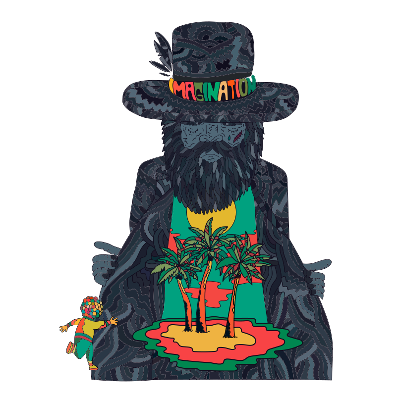

<p align="center">
  
</p>

<h3 align="center">
  <code>FOSTER THE PEOPLE</code>
</h3>

<p align="center">
  A cinematic landing page celebrating <em>Imagination</em> — a psychedelic journey<br/>
  into a world where reality meets dreams.
</p>

<p align="center">
  <a href="https://imagination-murex.vercel.app"><strong>imagination-murex.vercel.app</strong></a>
</p>

<br/>

<p align="center">
  
  
  
  
  
  
</p>

---

## The Experience

> *"Imagination is an invitation to escape the ordinary, explore the unknown, and discover the extraordinary worlds that live within us."*

A single-page, immersive landing experience built as an independent fan-made concept for Foster the People's *Imagination*. Designed to feel like a cinematic journey — every scroll reveals a new chapter.

<br/>

## Sections

| # | Section | Description |
|:-:|---------|-------------|
| 01 | **Hero** | Full-screen opener with animated headline, streaming popover (Spotify / YouTube / Play Now), and scroll cue |
| 02 | **Album** | Editorial two-column layout with image carousel (Embla) featuring album artwork studies |
| 03 | **Tracks** | Interactive tracklist with audio playback — tap to preview each track with synchronized play/pause |
| 04 | **Visual Universe** | Pinterest-style masonry gallery using CSS `columns` — a curated collection of artwork and visuals |
| 05 | **About** | Closing landscape with ambient radial glow, headline, and footer attribution |

<br/>

## Design Tokens

The visual language is defined through CSS custom properties — no `tailwind.config` file, everything lives in CSS with Tailwind v4.

| Token | Color | Hex | Role |
|:-----:|:-----:|-----|------|
| `$night` |  | `#0b0916` | Deep navy — primary background |
| `$sun` |  | `#f5c543` | Warm yellow — wordmark & accents |
| `$lagoon` |  | `#2dd4bf` | Turquoise — eyebrows & highlights |
| `$paper` |  | `#f5f0e8` | Ivory — headings & primary text |
| `$haze` |  | `#8D7BA8` | Lavender — body text & subtle elements |
| `$tangerine` |  | `#FF7438` | Orange — decorative glows |

**Typography**: Playfair Display (display) + Inter (body)

<br/>

## Architecture

```
src/
├── main.tsx                        # Lenis smooth scroll provider
├── App.tsx                         # Section composition + image preloading
├── index.css                       # Tailwind v4 + design tokens
│
├── components/
│   ├── Header/                     # Fixed nav with smooth scroll (Lenis)
│   ├── ImageCarousel/              # Embla-powered artwork carousel
│   ├── ListenPopover/              # Streaming platform links + in-page play
│   ├── MusicToggle/                # Floating background music button
│   └── TrackRow/                   # Individual track with play/pause
│
├── pages/
│   ├── Home/                       # 01 — Hero section
│   ├── Album/                      # 02 — Album editorial
│   ├── Tracks/                     # 03 — Tracklist with audio
│   ├── VisualUniverse/             # 04 — Masonry artwork gallery
│   └── About/                      # 05 — Closing landscape
│
├── assets/images/                  # All images as WebP (bundler-hashed)
│
└── lib/
    ├── audio-lock.ts               # Shared lock — only one audio source at a time
    ├── preload-images.ts           # requestIdleCallback-based image preloading
    └── use-preload-images.ts       # React hook for idle-time prefetching
```

<br/>

## Tech Stack

| Layer | Technology | Why |
|-------|-----------|-----|
| **Framework** | React 19 + TypeScript (strict) | Latest React with full type safety |
| **Build** | Vite 8 + pnpm | Fast HMR, optimized builds |
| **Styling** | Tailwind CSS v4 | Utility-first, configured in CSS (no config file) |
| **Animation** | Motion (Framer Motion) | `whileInView` animations with `viewport={{ once: true }}` |
| **Smooth Scroll** | Lenis | Butter-smooth scroll + programmatic `scrollTo` for nav |
| **Carousel** | Embla Carousel | Lightweight, extensible carousel with autoplay |
| **Icons** | lucide-react | Tree-shakeable SVG icons |
| **Lint & Format** | Biome | Single tool replacing ESLint + Prettier |
| **Unit Tests** | Vitest + Testing Library + MSW | Component testing with mocked APIs |
| **E2E Tests** | Playwright (Chromium) | Tests run against production build |

<br/>

## Audio System

The page features two audio sources that never overlap:

- **MusicToggle** — floating button (bottom-right) that plays background music, auto-starting on first user interaction (respecting browser autoplay policy)
- **Tracks** — individual track previews in the tracklist section

A shared **audio lock** (`src/lib/audio-lock.ts`) ensures mutual exclusivity: claiming audio stops any other source currently playing.

<br/>

## Performance

- **Image preloading** — all gallery images are prefetched during idle time via `requestIdleCallback`
- **WebP format** — every image is converted to WebP for smaller payloads
- **Content-hashed assets** — images in `src/assets/` go through Vite's bundler for cache-busting filenames
- **Lazy loading** — gallery images use native `loading="lazy"`
- **Immutable cache headers** — production preview serves assets with `max-age=31536000, immutable`

<br/>

## Getting Started

```bash
# Install dependencies
pnpm install

# Start dev server
pnpm dev

# Build for production
pnpm build

# Preview production build
pnpm preview
```

## Scripts

```bash
pnpm dev          # Development server
pnpm build        # Production build
pnpm preview      # Preview production build
pnpm typecheck    # TypeScript checking (tsc -b)
pnpm check        # Biome lint & format check
pnpm check:fix    # Auto-fix lint & format issues
pnpm test         # Unit tests (watch mode)
pnpm test:ci      # Unit tests (single run)
pnpm test:e2e     # E2E tests (builds + runs against preview)
```

<br/>

## Testing

**63 unit tests** + **51 E2E tests** covering every section.

```bash
# Full verification pipeline
pnpm typecheck && pnpm check && pnpm test:ci && pnpm test:e2e
```

- Unit tests live alongside components (`Component.test.tsx`)
- E2E tests run against the production build (`vite preview` on port 4173)
- Locators scoped by section ID to avoid ambiguity across repeated elements

<br/>

## Conventions

- **Commits**: Conventional Commits + [Gitmoji](https://gitmoji.dev) — `✨ feat: add hero section`
- **Exports**: Named exports only (no `export default`)
- **Imports**: Relative paths with extensions (`./App.tsx`)
- **Formatting**: Biome defaults — tabs + double quotes
- **Components**: `src/components/<Name>/index.tsx` with tests alongside

<br/>

---

<p align="center">
  <strong>INDEPENDENT FAN-MADE CONCEPT</strong><br/>
  <sub>This project is not affiliated with Foster the People or their label.<br/>Built with craft and admiration for the music.</sub>
</p>

<p align="center">
  <sub>Made by <a href="https://github.com/wevisonramalho">Wevison Ramalho</a></sub>
</p>
